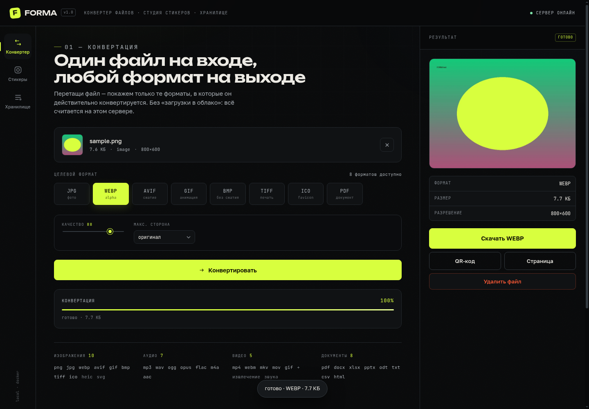
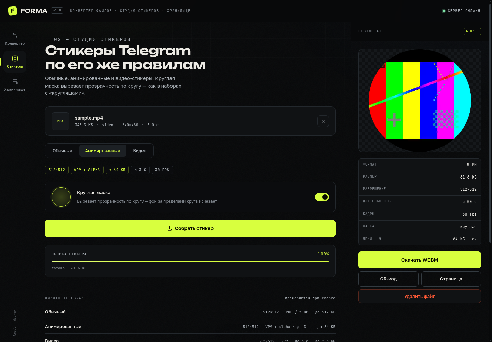
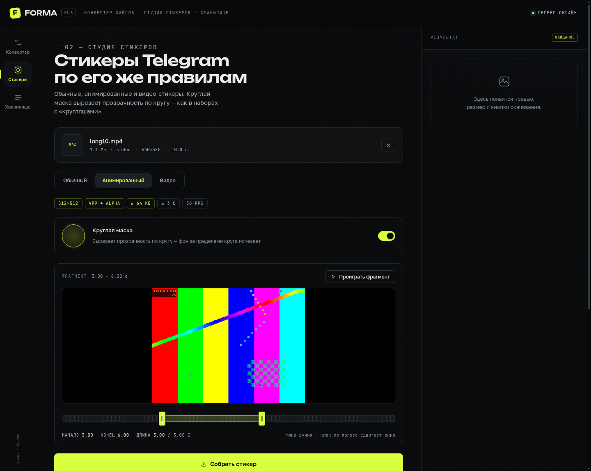
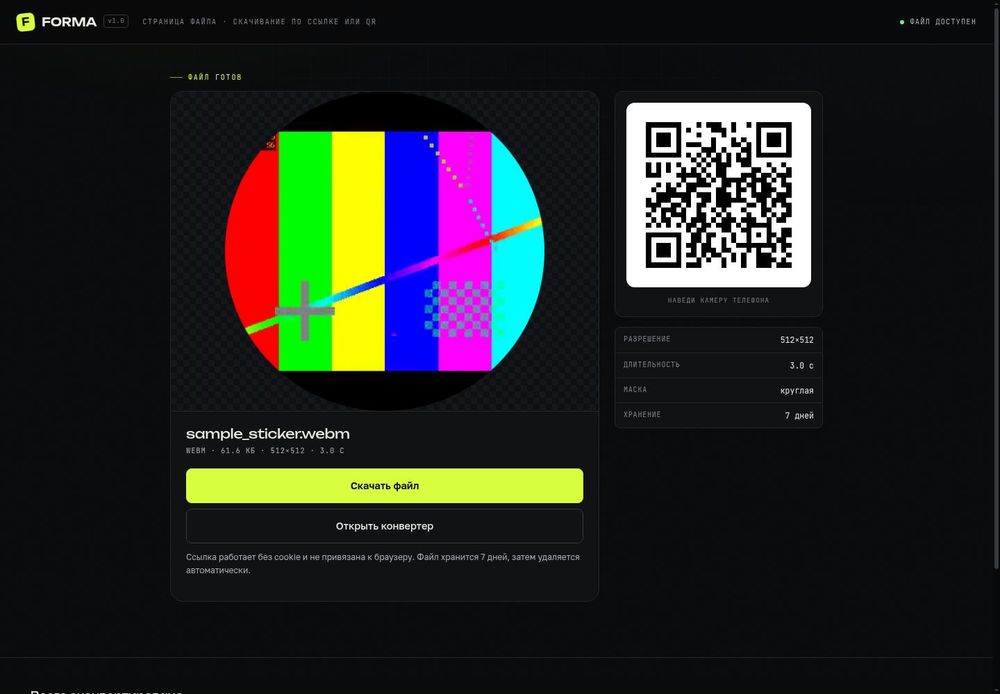

# FORMA — конвертер файлов и студия стикеров

Самодостаточный сервис в Docker: конвертация изображений, аудио, видео и документов,
студия стикеров Telegram (обычные, анимированные, видео + круглая маска),
хранилище результатов с привязкой к cookie, скачивание по QR-коду.

## Скриншоты

| Конвертер | Студия стикеров |
|---|---|
|  |  |

| Редактор фрагмента | Страница скачивания |
|---|---|
|  |  |

## Запуск

```bash
docker compose up -d --build
```

Сервис слушает `8080`. Если Docker-демон удалённый (`DOCKER_HOST=tcp://…`),
порт открывается на **хосте демона**, а не на localhost — адрес вида
`http://<ip-демона>:8080`. Этот же адрес нужно положить в `PUBLIC_BASE_URL`,
иначе QR-коды будут вести на localhost.

Без compose:

```bash
docker build -t forma .
docker run -d --name forma --restart unless-stopped -p 8080:8080 \
  -e PUBLIC_BASE_URL=http://192.168.1.194:8080 \
  -v forma_data:/data --shm-size=512m forma
```

## Что внутри

| Слой | Технологии |
|---|---|
| Бэкенд | Python 3.12, FastAPI, uvicorn, SQLite (WAL) |
| Медиа | ffmpeg (libx264, libvpx-vp9, libopus, libmp3lame, libaom), avifenc |
| Изображения | Pillow + pillow-heif (HEIC/HEIF), rsvg-convert (SVG) |
| Документы | LibreOffice headless, poppler-utils (pdftoppm/pdftotext/pdftohtml) |
| Фронтенд | ванильный HTML/CSS/JS, self-hosted шрифты (Unbounded, Golos Text, JetBrains Mono) |

## Матрица конвертации

- **Изображения:** png, jpg, webp, avif, gif, bmp, tiff, ico, heic, svg → png/jpg/webp/avif/gif/bmp/tiff/ico/pdf
- **Аудио:** mp3, wav, ogg, opus, flac, m4a, aac, wma, aiff → mp3/wav/ogg/opus/flac/m4a/aac
- **Видео:** mp4, webm, mkv, mov, avi, m4v, mpg, ts, flv, wmv, 3gp → mp4/webm/mkv/mov/gif + извлечение mp3/wav
- **Документы:** pdf, docx, doc, odt, rtf, txt, md, html, xlsx, xls, ods, csv, pptx, ppt, odp → pdf/txt/html/docx/odt/csv/png/jpg

Список целевых форматов для конкретного файла отдаёт `POST /api/upload`
(поле `targets`) — интерфейс показывает только то, что реально поддерживается.

## Стикеры Telegram

| Тип | Формат | Ограничения |
|---|---|---|
| Обычный | PNG / WEBP | 512×512, ≤ 512 КБ |
| Анимированный | VP9 / WebM + alpha | 512×512, ≤ 3 с, ≤ 64 КБ, 30 fps |
| Видео | VP9 / WebM | 512×512, ≤ 3 с, ≤ 256 КБ, 30 fps |

Круглая маска вырезает прозрачность по кругу (альфа-канал через `alphamerge`).
Кодировщик сам подбирает CRF и fps, чтобы попасть в лимит размера.

### Редактор фрагмента

Для видео и GIF в студии появляется таймлайн: две ручки задают начало и конец,
окно не длиннее 3 с (лимит Telegram). Кадр в превью перескакивает на ту точку,
которую тянешь, кнопка «Проиграть фрагмент» проигрывает ровно выбранный кусок.
Сборка идёт по выбранному диапазону (`start` + `duration` в `/api/sticker`).

Для форматов, которые браузер не проигрывает (mkv, avi, gif), сервер на лету
собирает mp4-превью 480p в `/data/previews` — редактор работает одинаково.

## API

| Метод | Путь | Назначение |
|---|---|---|
| POST | `/api/upload` | загрузка файла, возвращает `id`, `kind`, `targets` |
| POST | `/api/convert` | `{id, target, opts}` → `{job}` |
| POST | `/api/sticker` | `{id, mode, mask}` → `{job}` |
| GET | `/api/job/{id}` | статус, прогресс, результат |
| GET | `/api/library` | файлы текущей cookie-сессии |
| DELETE | `/api/file/{id}` | удалить файл |
| GET | `/api/stats` | суммарный объём и разбивка |
| GET | `/f/{id}` | скачать файл |
| GET | `/p/{id}` | превью inline |
| GET | `/d/{id}` | страница файла (для QR) |
| GET | `/qr/{id}.png` | QR-код на страницу файла |

## Хранение

- Файлы: `/data/files/<session>/<id>.<ext>`, метаданные — `/data/forma.db`
- Сессия — cookie `forma_sid` (httpOnly, 1 год)
- Автоочистка: файлы старше `TTL_DAYS` (по умолчанию 7) удаляются джантором каждые 6 часов
- Ссылки `/d/{id}` и `/f/{id}` работают без cookie — так и задумано для QR

## Особенности окружения

- LibreOffice в контейнере при первом запуске с новым профилем завершается кодом 81
  и ничего не делает — профиль только инициализируется. Поэтому профиль общий
  (`/tmp/lo_profile`), а конвертация делает до трёх попыток. При старте есть прогрев.
- Нативный декодер VP9 в ffmpeg игнорирует альфа-слой: проверять прозрачность
  стикеров нужно с `-c:v libvpx-vp9`.
- HTML/Web-документ нельзя экспортировать в docx напрямую — только через odt.
